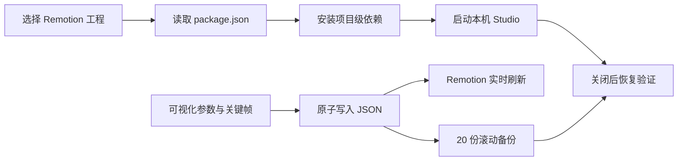

# Remotion Project Manager · Remotion 工程管家

[](https://github.com/xuguohua318/remotion-project-manager/releases)
[](LICENSE)
[](#系统要求)

**把散落的 Remotion 工程变成可长期保存、随时恢复、可视化调参的本地工作台。**

Remotion Project Manager is a Windows desktop application for managing persistent Remotion projects, editing JSON parameters and keyframes, launching Studio, rendering, and verifying that a project can be restored after every service is closed.

> 工程源码、素材引用、参数 JSON 和关键帧始终保存在原项目目录中。软件不会把临时服务器或自己的数据库当作工程的唯一存储位置。

## 为什么需要它

- **统一工程入口**：导入、拖入或扫描多个 Remotion 工程，不再反复寻找命令和目录。
- **参数与关键帧编辑器**：通过 JSON Schema 生成滑块、颜色、布尔和枚举控件；在当前帧修改数值会自动创建或更新关键帧。
- **Studio 实时同步**：自动使用 `--props=<settings.json>` 启动 Studio，保存参数后 Remotion 会立即读取新值。
- **可靠的依赖管理**：npm 工程自动选择 `npm ci` 或 `npm install`，依赖留在各工程中，避免全局版本冲突。
- **可恢复，而不只是“上次还开着”**：一键记录哈希、停止 Studio、重新枚举合成项、重启预览并比较参数与关键帧。
- **本地、安全、可迁移**：备份、验证记录和接入清单跟随源工程，可复制到其他电脑或提交 Git。



## 功能

| 能力 | 状态 |
| --- | --- |
| 多工程列表、文件夹选择、目录扫描 | ✅ |
| npm 安装、Studio、check、render、still | ✅ |
| 中文路径、空格路径、自动端口识别 | ✅ |
| JSON Schema 参数面板与关键帧轨道 | ✅ |
| JSON 导入、导出、撤销、写前备份 | ✅ |
| Studio 内嵌预览与浏览器外开 | ✅ |
| 关闭后持久化恢复验证 | ✅ |
| pnpm / Yarn / Bun | 识别并提示，暂不自动执行 |

## 快速开始

### 从源码运行

```powershell
git clone https://github.com/xuguohua318/remotion-project-manager.git
cd remotion-project-manager
npm install
npm start
```

### 构建 Windows 安装包

```powershell
npm run make
```

构建结果位于：

- `out/make/squirrel.windows/x64/RemotionProjectManager-Setup.exe`
- `out/make/zip/win32/x64/Remotion 工程管家-win32-x64-<version>.zip`

## 系统要求

- Windows 10 / 11 x64
- Node.js 22 或更高版本（推荐 Node.js 22/24）
- npm
- 第一次安装工程依赖时需要网络

软件会优先检测 `C:\Meapp\node`，也可以在左下角设置中选择其他同时包含 `node.exe` 与 `npm.cmd` 的目录。

## 接入现有 Remotion 工程

没有参数清单的工程仍然可以启动 Studio、检查和渲染。若要使用可视化参数编辑，请在工程根目录添加：

```json
{
  "version": 1,
  "displayName": "MyComposition",
  "entry": "src/index.ts",
  "packageManager": "npm",
  "scripts": {
    "studio": "start",
    "render": "render",
    "still": "still"
  },
  "settings": {
    "file": "default-settings.json",
    "schema": "remotion-manager.schema.json",
    "compositionId": "MyComposition",
    "timeline": {"fps": 30, "durationInFrames": 300},
    "keyframes": {
      "containerPath": "cameraKeyframes",
      "easingPath": "cameraEase"
    }
  }
}
```

也可以直接在软件的“参数与关键帧”页运行接入向导。Remotion 组件可通过 `getInputProps()` 使用这份 JSON；工程管家启动 Studio、渲染视频和导出静帧时都会传入同一参数文件。

## 持久化文件

- `remotion-manager.json`：工程入口、脚本、合成项、时间线和参数文件映射。
- `remotion-manager.schema.json`：标准 JSON Schema 与 `x-remotion-ui` 界面提示。
- `.remotion-manager/backups/`：每次参数写入前创建的滚动备份，默认保留最近 20 份。
- `.remotion-manager/verification/latest.json`：最近一次关闭后恢复验证结果。
- `VERIFICATION.md`：可随工程提交的可读验证记录。

软件自身只在 `%APPDATA%\RemotionProjectManager` 保存最近项目路径和界面偏好，日志位于 `%LOCALAPPDATA%\RemotionProjectManager\logs`。

## 安全设计

- Electron 启用 `contextIsolation` 和沙箱，关闭 `nodeIntegration`。
- 内嵌 Studio 只允许访问本机回环地址。
- 渲染进程只获得类型化 IPC，不暴露任意命令执行接口。
- 只执行工程清单或 `package.json` 中声明的、通过名称校验的 npm 脚本。
- 参数路径必须位于工程目录内，写入前执行 Schema 与关键帧范围校验。

## 开发与贡献

```powershell
npm install
npm test
npm run typecheck
npm start
```

欢迎提交 Issue、功能建议和 Pull Request。请先阅读 [CONTRIBUTING.md](CONTRIBUTING.md)。

## 路线图

- 完整支持 pnpm、Yarn 与 Bun
- 项目模板与参数 Schema 市场
- 可配置渲染队列与进度面板
- 备份差异查看与一键恢复
- 可选 Git/GitHub 工作流集成

## License

[MIT](LICENSE) © 2026 Xu Shuai

Remotion is a trademark of its respective owner. This project is an independent community tool and is not affiliated with or endorsed by Remotion.
